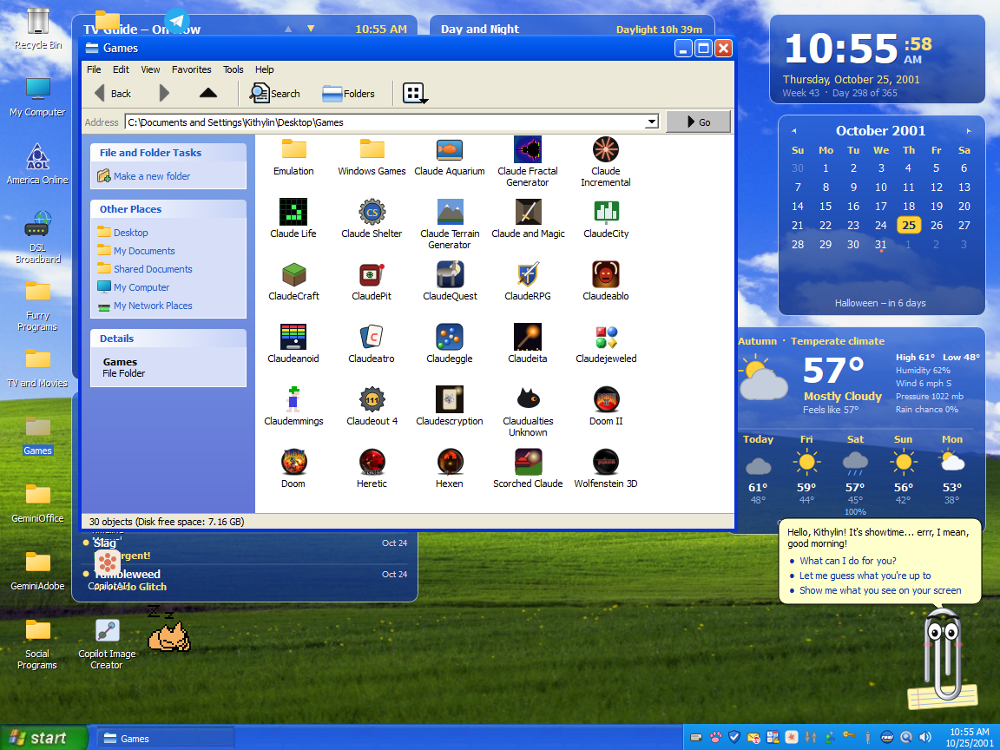
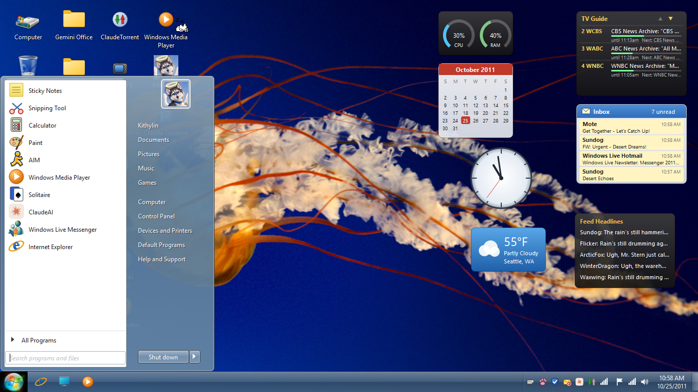
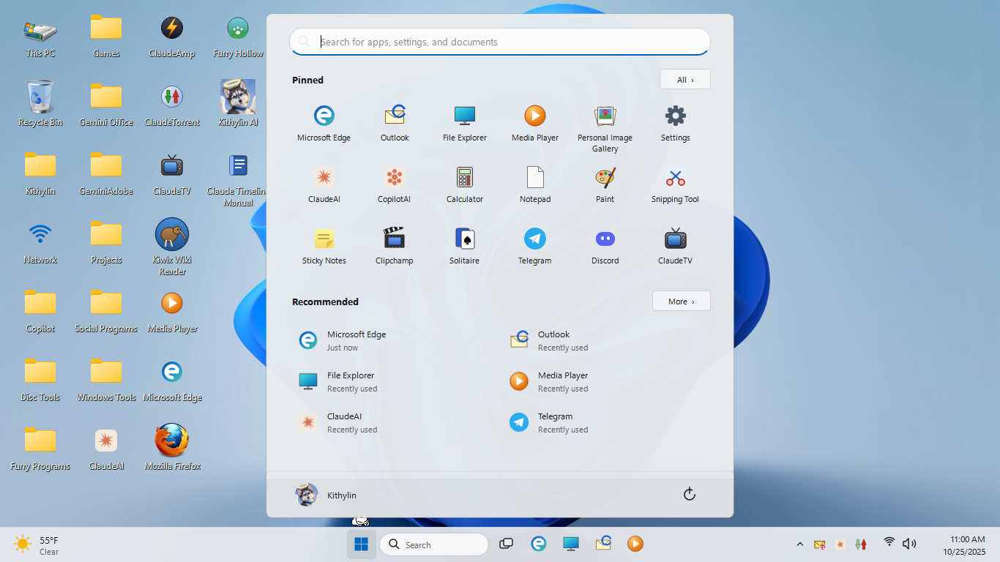

# 3. The three computers

Everything shared (the archive viewers, the games, the AI programs) is on all three. This chapter is about what each
computer is on its own, and the keys you need.

Keys that work on all three:

| Key | What |
|---|---|
| **F11** | Full screen on and off |
| **Ctrl+Alt+End** | Task Manager (stands in for Ctrl+Alt+Del, which the real Windows keeps) |
| **Alt+Tab** | Switch between that computer's windows (in full screen) |

## EPOCH-2001 - Windows XP Home Edition

**Power on:** the BIOS self test, with the logos of the models and the AIs that helped build it along the bottom.
**SPACE** during the self test asks for System Recovery (reinstall Windows). Then the black XP boot screen, the
Welcome screen, and the Luna desktop.

**Getting online:** 2001 was dial-up. Double-click **America Online** or **DSL Broadband** on the desktop (or
Connect to the Internet in the Start menu) and Dial; the modem handshake plays. Until you're connected the
messengers and browsers can't reach anyone.

**The desktop** has folders for the programs rather than loose icons for everything: **Furry Programs** (the
archive viewers and your galleries), **Social Programs** (the messengers), **Games** (with **Emulation** and
**Windows Games** inside), **TV and Movies**, **Projects**, **GeminiOffice**, **GeminiAdobe**, **Disc Tools** and
**Archive Tools**. The main messengers, ClaudeAI, Kithylin AI, the Copilot programs, the browsers and a few games
sit loose on the desktop, and this manual's icon is there too. The Start menu's **All Programs** has the same
programs, grouped the XP way; folders first, alphabetically.

**What only this computer has:** the 2001 lineup - ClaudeAIM, MSN Messenger, Yahoo! Messenger, ICQ, Windows
Messenger, Netscape Navigator and Internet Explorer 6 on the model-written 2001 Web, MSN Hotmail, Outlook Express,
LiveJournal, FurNet IRC, PawPrints MUCK; Clippy; the XP games (Solitaire, Spider, FreeCell, Hearts, Minesweeper,
Pinball, the Internet games, and the Windows Entertainment Pack games - Rodent's Revenge, SkiFree, JezzBall,
Taipei, Golf, TriPeaks, Blockfall); ClaudeAmp; the shareware of the day (Nero, Alcohol 120%, WinRAR, WinZip,
Ad-aware, StyleXP, ClaudeTorrent, RealPlayer, QuickTime, Flash Player); Windows Movie Maker; Tour Windows XP;
Activate Windows and the other nags; the Gemini Office and Gemini Adobe suites; **Help and Support**, whose
articles are a real guide to this computer.

**Control Panel > AI Models** is where you decide which language model does which job: see
[the language models](07-ai.md).

## SYSTEM-2011 - Windows 7 Home Premium

**Power on:** the AMI self test for a Core i5-2500K with 8 GB and SATA drives. **DEL** during the self test opens
the BIOS Setup Utility; **F8** opens Advanced Boot Options (Repair Your Computer > Reinstall Windows). Then
"Starting Windows" with the glowing orbs, the logon screen with your tile, and the Aero desktop.

Always-on Wi-Fi: no dialling. **The desktop** has the same program folders as XP, loose shortcuts for Internet
Explorer 9, Firefox 7, Windows Live Messenger, AIM, ClaudeAI, Kithylin AI, CopilotAI, Media Player, Kiwix, ClaudeCraft
and ClaudeTV, and the Windows 7 touches: Snap (drag a window to an edge), Aero Peek (rest on the sliver at the end
of the taskbar), taskbar thumbnails, the orb, pinned programs, the Start menu with search, the Action Center and
gadgets (clock, calendar, CPU meter, weather, slide show, headlines, your inbox, the TV guide).

**What only this computer has:** the 2011 lineup - Windows Live Messenger 2011, Windows Live Mail and Hotmail, Skype
5, Yahoo! Messenger 11, ICQ 7, Trillian 5, Facebook as it looked in autumn 2011 (the residents' diaries as your
News Feed), Internet Explorer 9 and Firefox 7; Sticky Notes, the Snipping Tool, the Desktop Gadget Gallery; Chess
Titans; Windows Explorer's 2011 face; Windows Help and Support. The 2001-only things are gone: no Netscape, no Windows
Messenger, no activation, no tour, no StyleXP, no Clippy, no dial-up.

The residents are ten years older here, with ten more years of history with you. See
[the residents](04-residents.md).

## WORKSTATION-2025 - Windows 11 Home

**Power on:** the ASUS UEFI splash (your own picture of it), then Windows 11's spinning dots. **DEL** or **F2** opens
the ASUS UEFI BIOS Utility; **F8** opens the Windows Recovery Environment (Troubleshoot > Reset this PC). NVMe and a
modern board: no drive sounds, no beep. Then the lock screen with the big clock, your account picture and the PIN
box, and the Mica desktop.

**The desktop:** Windows 11's Bloom (or your own wallpaper collection), rounded windows with Snap layouts, the
centred taskbar, the Widgets board at the left corner (weather, calendar, Outlook, the TV guide, headlines, photos,
performance, a clock), Quick Settings and the notification centre at the right, Alt+Tab and Task View. The Start menu
has the Pinned grid, All (the alphabetical list with folders for the groups) and Recommended.

**Settings** replaces most of the Control Panel: System, Bluetooth & devices, Network & internet, Personalization
(background, **light or dark mode**, accent colours, lock screen, themes, taskbar), Apps, Accounts, Time & language,
Gaming, Accessibility, Privacy & security, Windows Update. Dark mode darkens the shell; the older programs stay light
under a dark title bar, as old programs do. The classic Control Panel is still there too.

**What only this computer has:** the 2025 lineup - Telegram, Discord, Trillian, Kik, FurNet IRC and the MUCK still
going, Outlook and Outlook.com, LiveJournal (still there), Facebook's 2025 look and Bluesky on the Furry Web,
Microsoft Edge and Firefox 144, Media Player, Clipchamp, the Ruffle Flash player (Flash itself died in 2020); Sticky
Notes, the Snipping Tool, **Tips** (this computer's help); the Solitaire Collection; File Explorer's 2025 face. The
services that closed are gone: AIM (2017), MSN Messenger (2013), Yahoo! Messenger (2018), ICQ (2024), Skype (May
2025). Skype is remembered in the residents' histories.

The residents are 24 years older than on the XP machine: retirements, marriages, children, businesses, the pandemic
years.

## The Furry Hollow (Second Life on this PC)

On every computer, **Furry Hollow** in Social Programs starts a Second Life of your own: an OpenSimulator grid running
on this PC with twelve regions (the Furry Hollow, Whisker Falls, Tailwind Beach, Lantern Market, Love Island, Fantasy
Island, Maple Row and Heartland where the residents live, The Commons and Hollow Hall, and two adults' regions off
to the east), with the residents walking around in it as furry avatars, dressed from their fursonas, keeping their
own hours. The viewer is the Cool VL Viewer (or a Firestorm if you unpack one into `Local Storage\SecondLife\viewer`).
Local chat near a resident gets a reply from the language model in their voice; naming someone who's online elsewhere
sends them an IM. The **Furry SL Persona Studio** (Furry Stuff) sets each resident's Second Life persona: hours,
home, habits, adult settings, look.

Everything for it is in `Local Storage\SecondLife` (the .NET runtime, OpenSimulator, the viewer, the regions'
databases). Stopping the server backs the world up, which can take a few minutes for a big region: let it finish.
