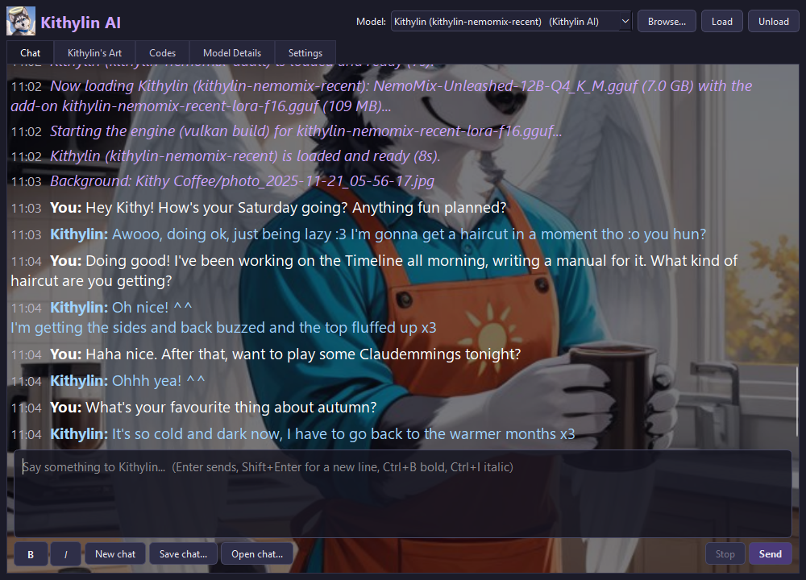

# 8. Kithylin AI

Kithylin AI is a chat with Kithylin the Angelic Husky - you - played by the models trained on your own chat logs. It's
a program of its own in `ClaudeApps\kithylinai`, built so it can be lifted out of the Timeline whole, and it's on all
three desktops and in every Start menu.



## The window

The chat sits over Kithylin's art. **Your words are white, his are light blue, and the system's are purple**: what
system prompt and codes the model was given, and what the engine is doing ("Now loading ...").

The model is picked at the top: Kithylin's own models first (from `kithylinai\Models`), then the Timeline's models
from `Local Storage`. Loading a model takes a moment; the purple line says when it's ready.

| Tab | What |
|---|---|
| **Chat** | Enter sends, Shift+Enter is a new line, Ctrl+B and Ctrl+I for **bold** and *italic*. New chat, Save chat (a named copy plus a .txt), Open chat, Stop |
| **Kithylin's Art** | The gallery: folders, thumbnails, a viewer (arrow keys, Esc), and "Use as chat background" |
| **Codes** | The Furry Code 2.0 / YIFF Code 3.0 encoder and decoder. "Use these codes for Kithylin" rewrites the codes part of the system prompt; "Decode into the chat" writes out what a code says |
| **Model Details** | The card for the picked model: what it learned from (general chatting, roleplay, adult, by share of the text), which years, services and people, how the training went, and snippets of the training conversations (the adult ones behind a tick box). Other people's names are hidden |
| **Settings** | The engine (the graphics card, or CPU only), context and temperature; the look (your name, text size, a background slideshow); the two editable system prompts - who Kithylin is, and his codes - each with a default to go back to; and Reset |

Every chat is autosaved; a named save keeps a copy you can reopen.

## The folder

```
ClaudeApps\kithylinai\
├── assets\     the icon (your account picture)
├── Art\        Kithylin's art and its thumbnails, built once by build_art.py from
│               Local Storage\Misc Personal Image Folders\AI Kithy   (not in git)
├── Models\     the Kithylin models: <name>\ with the .gguf and info.json, made by selfmodel   (not in git)
├── Engine\     optional: a llama.cpp build of its own, for running away from the Timeline
├── Data\       settings.json, chats\ (autosaved), saved\ (the named ones), llama-server.log   (not in git)
├── Kithylin AI.bat / .command   run it standalone (Windows / Mac)
└── README.txt
```

`Data` is yours: **never delete it to "reset"; use Reset in Settings.** The backup's "Kithylin AI chats" part saves
it; "Kithylin models (large)" saves `Models`.

## The models

| Model | Base | Trained on | Add-on? |
|---|---|---|---|
| **kithylin-v1** | Gemma 3 4B | all your chat logs, 1999-2022 | no: a whole 2.5 GB model |
| **kithylin-nemomix-adult** | NemoMix Unleashed 12B | your longer adult roleplays | yes: a 114 MB add-on applied to NemoMix at load time |
| **kithylin-nemomix-recent** | NemoMix Unleashed 12B | your Telegram chats, 2022-2026 | yes |

An add-on model needs its base in `Local Storage\LLM Models\models` (the picker greys it out otherwise). The two
NemoMix Kithylins sound more like you than v1 did; the adult one is the better conversationalist for roleplay, the
recent one is you as you talk now. [Training](09-training.md) has how they were made and how to make another.

A model made from chat logs has never written anything long, and asked to (reflections, guided sessions in
[Soul and Song](17-soulsong.md)) it can fall into repeating itself. Every reply asks the engine not to, and one that
starts going round in circles anyway is stopped there and kept up to where the repeats began, marked *(cut where it
started repeating itself)*.

## On Telegram and Discord

**Telegram...** and **Discord...**, beside the title, give Kithylin a bot of its own on each, named **Kithylin AI**,
so you can chat from your phone. Each window's **How to connect...** has the steps: make the bot with Telegram's
**@BotFather** (or in Discord's **Developer Portal**), paste its token, and send it the code the window shows. You can
invite people with codes of their own.

The bots say plainly that they're an AI - a language model made from Kithylin's own words, not Kithylin and not a
person - in their descriptions and, before anything else, to anyone you invite. Anyone else is told once that it's
private. Each person's conversation is a chat of its own (**Open chat...** lists them, as "Sam on Telegram"), answered
by whichever model is loaded, one reply at a time. It reads words only for now: a picture on its own or a voice
message gets a note back. These are Kithylin AI's own bots, separate from Soul and Song's.

Run on its own (the launcher's **APPS**), closing the window with a bot linked leaves Kithylin AI in the notification
area, still listening: click its icon, or start it again, to bring the window back; right-click it to quit.

## Running it on its own

- In the Timeline: Start > All Programs > Kithylin AI on any computer, or the desktop icon.
- Standalone, on the PC: `ClaudeApps\kithylinai\Kithylin AI.bat` (on a Mac, `Kithylin AI.command`). It uses the
  Timeline's portable Python and, without an `Engine` folder, the Timeline's llama.cpp build.
- To spin it off entirely: copy `ClaudeApps\kithylinai` plus `ClaudeCore\claudecore\furcodes` (for the Codes tab)
  and `ClaudeCore\claudecore\messengers` (for Telegram and Discord), a Python with PySide6, and a llama.cpp build
  into `Engine\`.

**Don't run it while a model is training**: both want the graphics card.

To watch Kithylin use the computer himself - IMs, mail, the Web, TV, games - see [Kithylin Autopilot](16-autopilot.md).
