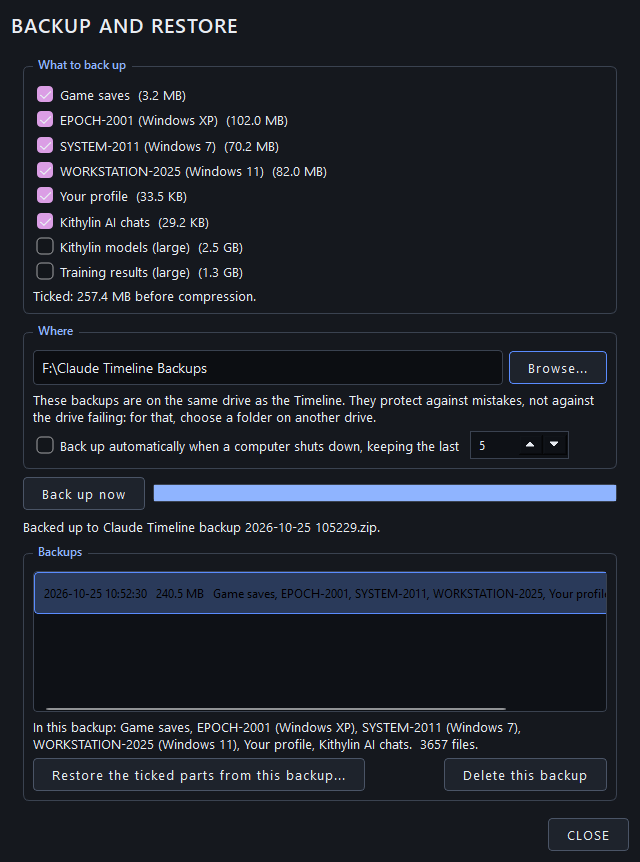

# 10. Backup and restore

Everything that's yours and small enough is backed up into one zip by the **BACKUP** button in the launcher, or by the
backup program inside each computer: **Backup Utility** on the XP machine (Accessories > System Tools), **Backup and
Restore** (Maintenance) on Windows 7, **Windows Backup** (Windows Tools) on Windows 11. They're the same panel in
different clothes.

## What's in a backup

| Part | What | On by default |
|---|---|---|
| **Game saves** | `ClaudeGames\Saves`: progress and high scores, shared by all three computers | yes |
| **EPOCH-2001 (Windows XP)** | `ClaudeXP\data`: its accounts, mail, chats, desktop, the residents' activity | yes |
| **SYSTEM-2011 (Windows 7)** | `Claude7\data` | yes |
| **WORKSTATION-2025 (Windows 11)** | `Claude11\data` | yes |
| **Your profile** | `Profile` and the launcher's settings: your identity, codes, these settings | yes |
| **Kithylin AI chats** | `ClaudeApps\kithylinai\Data`: its chats and settings | yes |
| **Soul and Song Companions** | `Local Storage\Projects\AI LLM Txt Files\Companions`: their minds, memories, chats and logs. Not restored while a computer runs (Soul and Song may have them open) | yes |
| **Kithylin models (large)** | `ClaudeApps\kithylinai\Models`: the trained Kithylins, about 2.5 GB | no |
| **Training results (large)** | the adapters and logs in `LLM Models\selfmodel`, about 700 MB | no |

A backup is one `.zip` named by date and time (`Claude Timeline backup 2026-10-24 1530.zip`; automatic ones say
`auto-backup`) with a `manifest.json` inside saying what's in it. Paths inside are relative to the Timeline folder, so
a backup restores onto any copy of the Timeline on any drive. Model files and media are stored, not compressed.

**Where:** by default a `Claude Timeline Backups` folder beside the Timeline, on the same drive. Better: point it at
another drive (**Browse...**), because a backup on the drive that fails is no backup. The panel warns when the folder
is on the same drive.

## Automatic backups

Tick **Back up automatically when a computer shuts down, keeping the last N** (default 5). Then every time a computer
shuts down, the launcher quietly makes a backup of the ticked parts and prunes the oldest automatic ones beyond N.
Named backups you made yourself are never pruned. A failed automatic backup never gets in the way.

## Restoring

Pick a backup in the list; the panel shows what it contains and when it was made. Tick the parts to put back and
click **Restore the ticked parts from this backup...**.

- A **safety backup** of what's about to be replaced is made first, so a restore can itself be undone.
- A computer's own data **can't be restored while that computer is running** (the files would be pulled out from
  under it). Restore it from the launcher with nothing running, or from one of the other computers.
- **Delete this backup** removes a zip.

## What a backup doesn't cover

- **Local Storage** (746 GB): the models, the archive, TV, ROMs, the Furry Hollow, your text logs. The cold copy on
  the 4 TB drive is its backup. Refresh it now and then; the text logs and the AI Kithy pictures change.
- **The code** is in git, pushed to GitHub. A fresh clone plus `Local Storage` plus a backup zip is a complete
  Timeline.
- **The portable Pythons** (`Python`, `Python-mac`) aren't in git either; [under the hood](13-under-the-hood.md)
  says how they were made.

## Load and Format, and Recovery Backups

**Load and Format** doesn't delete anything either: what it "erases" is moved to that computer's
`Recovery Backups\<date time>` folder. To undo a format by hand, shut the computer down and move the folder's
contents back into its `data`.

## The self-check and backups

The self-check warns when it's been a long while since the last backup, and flags the leftovers of an interrupted
backup or restore (a `.tmp` beside a zip, a half-moved folder) so they can be cleaned up before they cause trouble.
