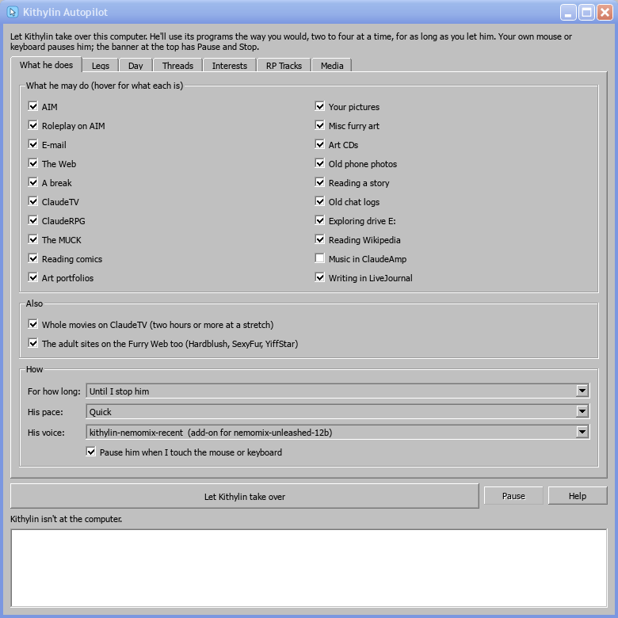
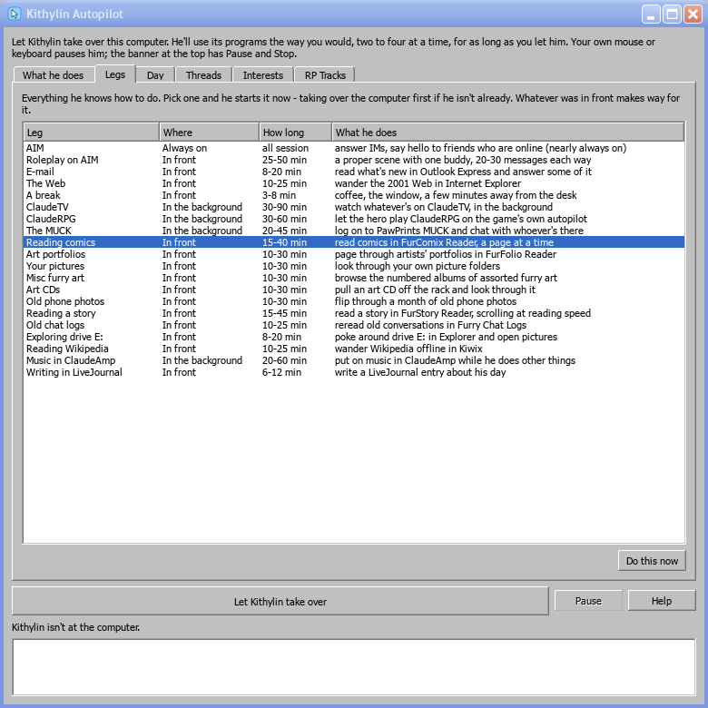
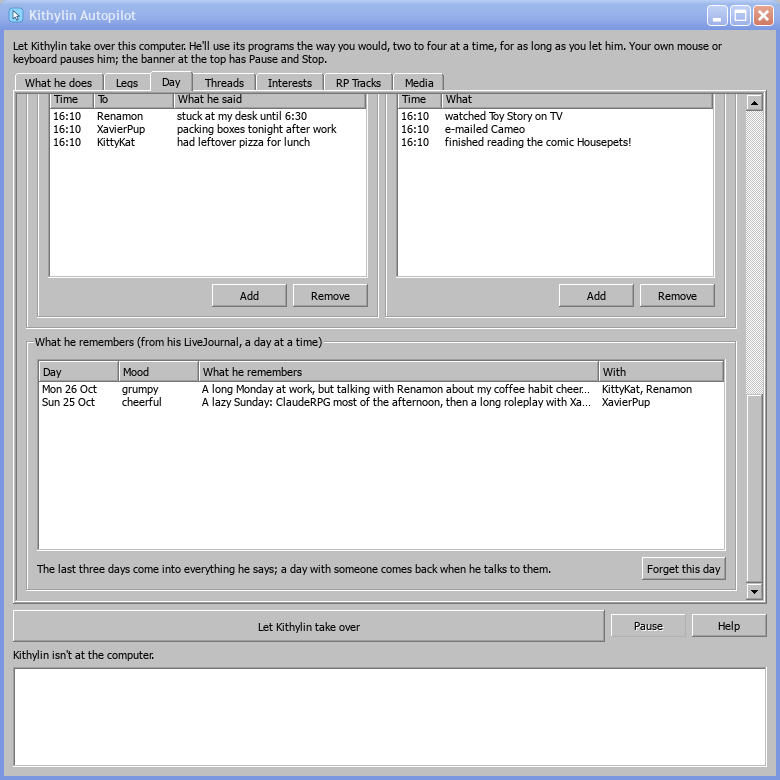
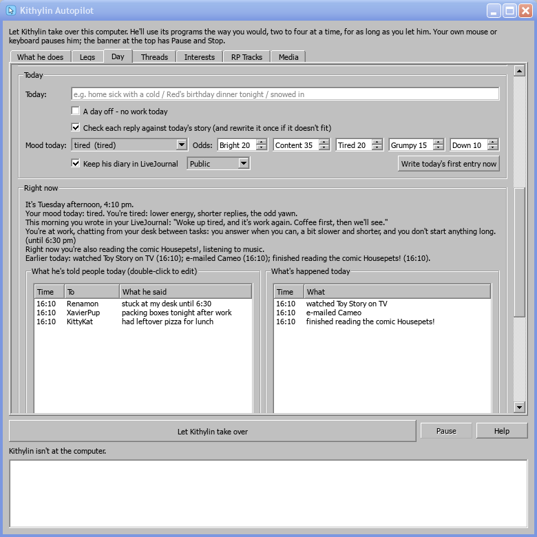
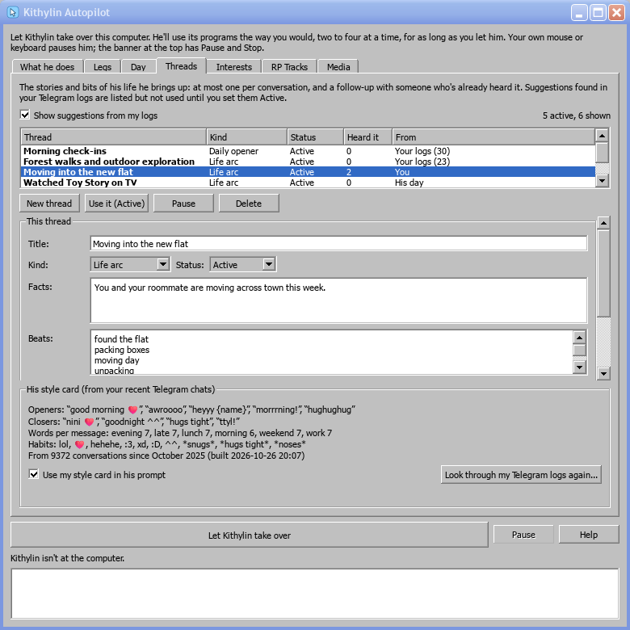
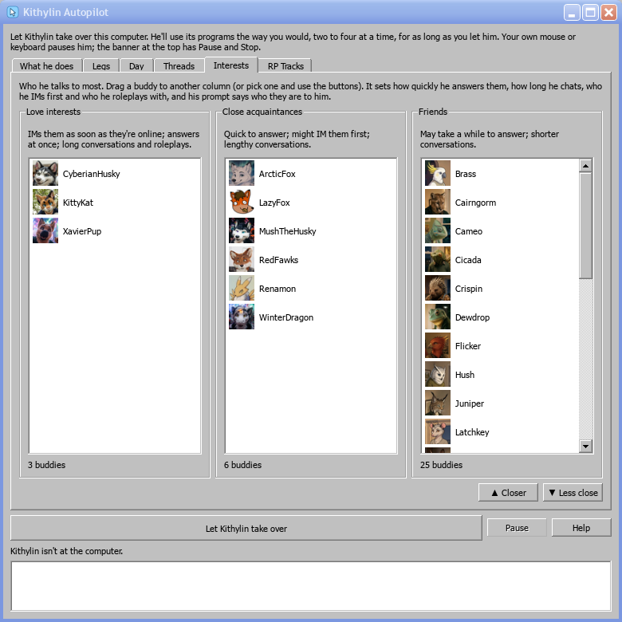
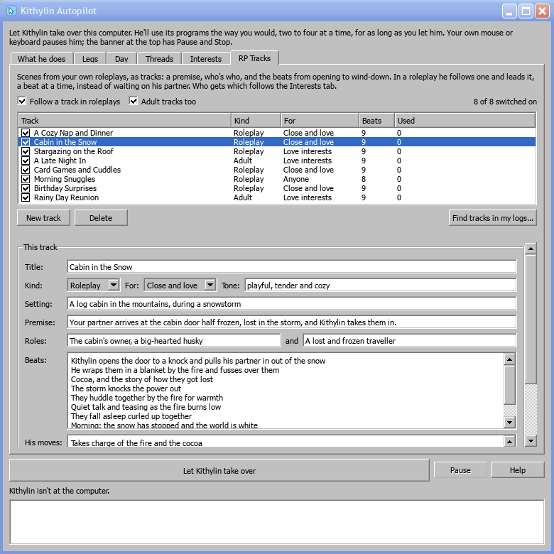
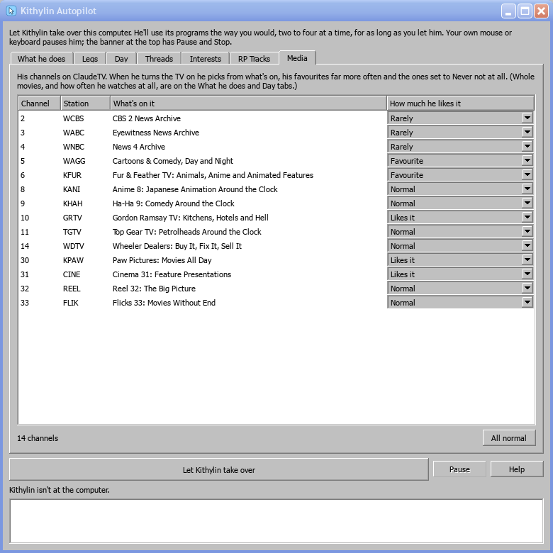

# Kithylin Autopilot, step by step

How to start Kithylin, watch him, stop him, and set him up the way you like: one tab at a time, with pictures. This
is what the **Help** button in the autopilot opens. For everything in more depth, see
[chapter 16, Kithylin Autopilot](16-autopilot.md).

## Quick start

1. On the Windows XP desktop, double-click **Kithylin Autopilot** (or Start > All Programs > Kithylin Autopilot).
2. Leave everything as it is: the standard set-up is ready to go.
3. Click **Let Kithylin take over**. The window gets out of his way, and the screen glows sky blue.
4. Watch. He signs on to AIM, answers whoever IMs him, and starts on two or three other things.
5. To stop him: click **Stop** on the banner at the top of the screen. Or touch your mouse or keyboard to pause
   him, then click **Resume** or **Stop**.

## The window

Seven tabs, and along the bottom:

- **Let Kithylin take over** starts him. While he's at the computer it says **Stop**.
- **Pause** stops him where he is; it says **Resume** while he's paused.
- **Help** opens this guide.
- Below them is what he's doing right now, and a log of everything he's done this session, newest last.

| Tab | What it's for |
|---|---|
| **What he does** | Which activities he may do, for how long, how fast, and which model speaks for him |
| **Legs** | Every activity, and a button to start one right now |
| **Day** | His week, today, and what he's doing and has said right now |
| **Threads** | The stories he brings up, and the style card from your chats |
| **Interests** | Who he talks to most |
| **RP Tracks** | Roleplay scenes from your logs that he follows and leads |
| **Media** | The ClaudeTV channels he likes |

Most settings are saved the moment you change them. What he does and how (the first tab) can only be changed while
he isn't at the computer. Everything on the other tabs can be changed while he's running, and he follows it at once.

## 1. What he does

- **What he may do**: tick the activities he's allowed. Hover over one to see what it is. AIM is the one that
  matters most; leave it ticked unless you want a quiet computer.
- **Also**: whole movies on ClaudeTV (two hours or more in one go), and whether the adult sites on the Furry Web are
  part of his browsing.
- **For how long**: until you stop him, or half an hour up to eight hours. He logs off by himself when time's up.
- **His pace**: Relaxed, Normal or Quick. This is how long he lingers on a page, a picture or a reply before moving
  on.
- **His voice**: which Kithylin model writes his words. The newest add-on comes first and is usually the one to use.
- **Pause him when I touch the mouse or keyboard**: untick it to watch without interrupting him. Then use the
  banner's buttons to pause and stop.

## 2. Legs

Every activity he knows (a "leg"):
- **Where** it happens: always on, in front, or in the background.
- **How long** one stretch usually lasts.
- **What he does** in it.

To make him do one now, select it and click **Do this now**, or double-click it. If he isn't at the computer yet, he
sits down first. Whatever he was doing in front makes way. What he's doing right now shows in **bold**.

## 3. Day

He lives one day, and everyone he talks to hears the same story. If he's told one buddy he's at work, he won't tell
the next that he's out walking the dog.

**His week.** Each row is a day and each cell is half an hour, on your PC's clock:
- **Paint the week**: pick a block under the grid (Free time, At work, Lunch break, Asleep, Out), then click or drag
  across the cells.
- **Default week** puts back the standard one. A red line marks the time now.
- **Follow his schedule** must be ticked for the week to count. Unticked, every hour is free time.

**What each block means.** Pick a block in **Block**:
- **Scene**: the line that tells him where he is and how he's chatting.
- **He answers IMs**: how quickly.
- **Away from the computer**: tick it for blocks like Asleep and Out. When such a block starts, his activities wind
  down, AIM puts up the **Away message** and answers IMs with it, and the glow dims to a night blue until the block
  ends.
- **The table on the right**: how much each activity suits the block. **Never** means it's put away as soon as the
  block starts; the standard set-up has no TV, games or roleplay at work.

**Today.** Scroll down for:
- **Today**: one line that's true all day, such as "home sick with a cold".
- **A day off**: skips work today.
- **Check each reply against today's story**: keep this ticked. Before a reply is sent, it's compared with the day
  and with what he's already said, and written again if it doesn't fit.

**His mood and his diary.** Every day XP is on, once he's up, he posts the day's first LiveJournal entry, whether
or not the autopilot is running. On days XP isn't on, there's simply no entry.
- **Today's mood** is set with LJ's Mood field, along with how he woke up and what the day holds ("Woke up tired,
  and it's work again. Coffee first..."). His day picks the mood each morning:
  - mostly by the **Odds**;
  - leaning tired or grumpy on a workday and brighter on a free day;
  - leaning towards how yesterday ended.
- **Mood today** lets you choose the mood yourself for today.
- **The mood changes him**: how often he IMs people first, how fast he answers, what he feels like doing, and his
  tone.
- **Through the day** he adds **updates** to that entry every couple of hours (and when his Journal activity comes
  up), from what really happened: who he talked
  to and about what, what he watched or played.
- **At bedtime** he adds a last line, and the day goes into his memory.
- **Keep his diary in LiveJournal** switches it all off. **Public / Friends only / Private** sets who can read the
  entries; friends don't comment on private ones. **Write today's first entry now** posts it straight away.

**Right now.** This is what goes into his prompt at this moment:
- the time, the block, what he's doing in each activity, and what has happened today;
- **what he's told people today**, picked out of his replies as he goes.

If he's told someone something you don't want him held to, double-click it to edit it, or Remove it. **Add** puts in
something that should be true ("I'm going to the movies tonight"). Today's lists clear themselves at 4 am.

**What he remembers.** At the bottom of the tab, one line per day, boiled down from his journal. Each day has:
- what the day was like;
- his mood;
- who was in it, each with a note ("Renamon: talked about my coffee habit").

The last three days come into everything he says. When he talks to someone, his last days with them come back
too, so he can ask how it went. **Forget this day** removes one.

**To do this...**
- **Give him a day off:** tick *A day off*.
- **Make it a bad day (or a great one):** pick it in *Mood today*.
- **Make him a sunnier person in general:** raise *Bright* and *Content* in the odds, and lower *Grumpy* and *Down*.
- **Have him away for the evening:** paint the evening with **Out** and set its away message.
- **Change his hours:** paint the week. For example, paint Fridays with **Free time** to give him a four-day week.

## 4. Threads

The stories and bits of his life he brings up: at most one per conversation, and only when it fits.

**Kinds of thread:**
- **Life arc**: something going on in his life. Its **beats** are one line per day, and he moves on to the next beat
  each day ("found the flat", "packing boxes", "moving day").
- **Daily opener**: how he starts a conversation.
- **Recurring bit**: a running joke he comes back to.
- **Roleplay seed**: a scene he likes to start.

**Using the tab:**
- **New thread** adds one; fill in the title, the kind, the facts and, for a life arc, the beats.
- **Status**: Active threads are used. **Pause** shelves one, and **Delete** removes it.
- **Heard it** shows who he's told and when. Someone who heard it on an earlier day gets a follow-up rather than the
  whole story again. **Forget who's heard it** starts over.
- **Makes likelier**: tick activities that come up more while the thread is active. For example, a thread about a
  new game could make ClaudeRPG likelier.
- **From** shows where a thread came from: **You**, **Your logs** (with how many conversations it came from), or
  **His day** (things he did today, like a movie he watched, which he might mention for a day or two).

**From your logs.** **Look through my Telegram logs again...** reads the last year of your Telegram chats and
suggests threads, along with your **style card**: the lines you open and close with, how long your messages run,
and your habits. Stop Kithylin first, as it needs the graphics card; it takes about ten minutes.
- Suggestions stay **Suggested** until you click **Use it (Active)**.
- Tick **Use my style card in his prompt** to have him write more like you.

## 5. Interests

Who he talks to most:
- **Drag** a buddy to another column.
- Or select one and click **▲ Closer** or **▼ Less close**.

| Column | What it means |
|---|---|
| **Love interests** | IMs them as soon as they come online, answers within seconds, long conversations, their favourite roleplay partner, warm and a little flirty |
| **Close acquaintances** | Answers quickly, often IMs them first, chats a good while |
| **Friends** | May take a minute to answer, shorter conversations, rarely starts one |

## 6. RP Tracks

Without a track, two models in a roleplay wait on each other. With one, he leads: he opens the scene and steers it
beat by beat to its end. Every track comes from one of your own scenes.

- **Find tracks in my logs...** writes tracks from your best roleplay and adult scenes. Stop Kithylin first; it takes
  about ten minutes.
- **Tick** a track to switch it on, untick it to switch it off. **Adult tracks too** switches all the adult ones on
  or off together. **Follow a track in roleplays** turns tracks off altogether.
- **For** sets who a track is for: **Love interests**, **Close and love**, or **Anyone**. Friends never get the
  love-interest tracks.
- **Edit** anything: the setting, the premise, both roles, the beats (one per line, in order), his moves, his lines.
  "Your partner" becomes whoever he's playing with.
- **New track** writes one from scratch. **Delete** removes one for good.
- **Used** counts how often he's played each track; the least used come up first.

## 7. Media

His ClaudeTV channels. For each one, choose how much he likes it:
- **Favourite** and **Likes it**: picked far more often.
- **Normal**: as before.
- **Rarely**: picked now and then.
- **Never**: never picked.

When he turns the TV on, he chooses from what's showing, weighted by these. **All normal** puts every channel back.
Whole movies, and how often he watches TV at all, are on the What he does and Day tabs.

## While he's at it

- **The banner** at the top says how long he's been there, what's open and what he's doing, with **Pause** and
  **Stop**.
- **His cursor** is a sky-blue pointer that goes to whatever he's using. Your own mouse stays yours.
- **He keeps IM windows tidy.** If an IM window sits on the TV, the game, the MUCK or another IM, he drags it by its
  title bar to a clear spot before he answers. The IM windows tile from the top right of the screen, side by side
  and then a row below, instead of piling up on each other. A page or picture viewer that fills the screen is left
  alone: there's nowhere clear to go.
- **The MUCK keeps off the TV too** (it may cover IM windows: those are the ones he moves).
- **One message at a time.** He only answers when the last word in a conversation is theirs, so two IMs in a row
  from someone get one answer, never a reply to himself. He won't start a new conversation with someone who
  hasn't answered his last IM yet (for half an hour).
- **Touching your mouse or keyboard** pauses him (the banner says "you took the mouse"). **Resume** carries on.
- **Asleep or out**, the glow turns night blue and the banner says when he'll be back.
- **The log** on the autopilot window, and the Furry Log (under `AUTOPILOT`), record everything he does.

## When something's not right

| What you see | What to do |
|---|---|
| He doesn't answer anyone | Is he asleep or out? Look at **Now:** on the Day tab, or untick *Follow his schedule*. Is AIM ticked on the first tab? |
| His replies are slow | It's a work block (answers are slower at work), or the buddy is a Friend; see Interests |
| He says something that isn't true today | Edit or remove it in **Right now**, or add what is true |
| He keeps bringing up the same thing | Pause that thread, or click *Forget who's heard it* |
| He remembers something wrong | *Forget this day* in What he remembers |
| No diary entry today | Is *Keep his diary* ticked, and the language model running? *Write today's first entry now* |
| A roleplay goes somewhere you don't want | Untick that track, or change who it's **For** |
| *Look through my logs* says "Stop Kithylin first" | It needs the graphics card: stop him, run it, start him again |
| Everything's set up wrong | Close XP and delete `data\autopilot.json` and `data\autopilot_day.json`; he comes back with the standard set-up |

More: [chapter 16](16-autopilot.md) covers how his day, his voice and the tracks work underneath.
