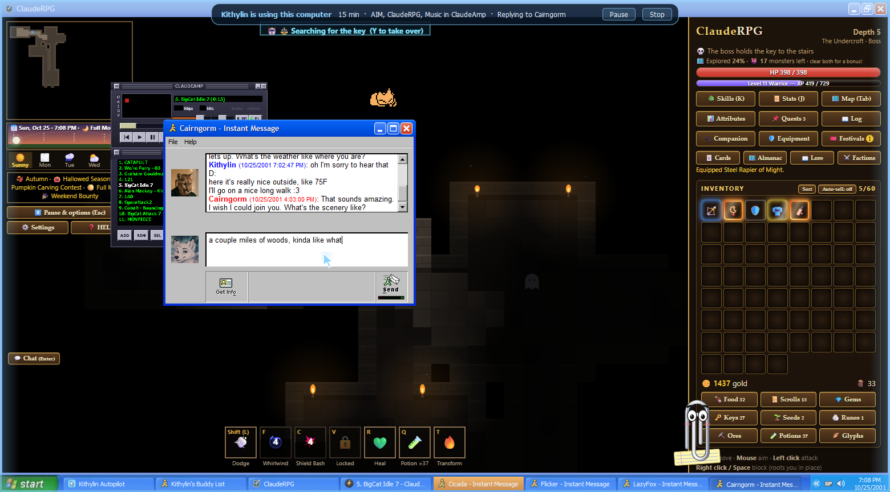
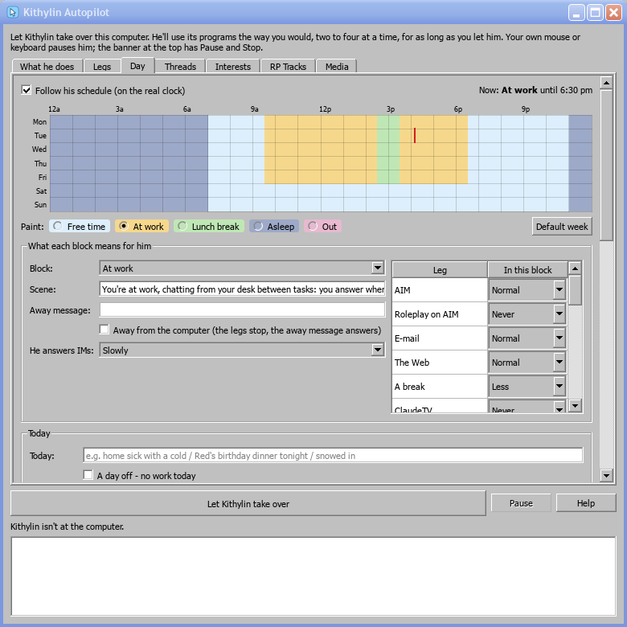

# 16. Kithylin Autopilot

Let Kithylin take over the computer. He sits down at EPOCH-2001 and uses it the way you would: answers whoever IMs
him on AIM, says hello to friends who come online, reads and answers his e-mail, wanders the 2001 Web, watches
ClaudeTV, logs on to the MUCK, lets his hero play ClaudeRPG, puts music on, reads comics and stories, pages through
the art in Local Storage, rereads old chat logs, writes in his LiveJournal and takes the odd break - two to four
things going at once, for as long as you let him. Think of it as a screen saver with someone home.

## Starting him

The **Kithylin Autopilot** icon on the Windows XP desktop (or Start > All Programs). The window has five tabs:

- **What he does** - tick what he may do (hover over one for what it is), choose how long he stays, his pace and
  his voice, and click **Let Kithylin take over**. The window minimises itself out of his way.
- **Legs** - everything he knows how to do, with where it happens (in front, in the background, or all session),
  how long a stretch usually lasts and what it is. Pick one and click **Do this now** (or double-click it): he
  takes over if he isn't already and starts it straight away; whatever was in front makes way. What he's doing
  right now shows in bold.
- **Day** - his week, today, and what's true right now (see *His day* below).
- **Threads** - the stories and bits of his life he brings up, and his style card (see *Threads* below).
- **Interests** - who he talks to most (see *Interests* below).

Activities you add later come in ticked; anything you untick stays unticked.

| Activity | What he does |
|---|---|
| **AIM** | Signs on (dialling up first if the modem's idle), answers IMs, now and then IMs someone who's online. A conversation runs its course: after a handful of exchanges he lets it rest for a while. Nearly always on |
| **Roleplay sessions** | A proper scene with one buddy, 20-30 messages each way, in *asterisks* |
| **E-mail** | Opens Outlook Express, reads what's new, answers some of it, occasionally writes to someone out of the blue |
| **The Web** | Internet Explorer: a link, a read, another link, a search now and then. The adult sites on the Furry Web only if you tick them |
| **ClaudeTV** | Picks a channel with something on and watches to the end; whole movies if allowed |
| **ClaudeRPG** | Through the splash and the title to his saved hero (or a new one), with the game's own autopilot switched on |
| **The MUCK** | Logged on to PawPrints in the background: listens, says something when there's something to answer, wanders |
| **Breaks** | Coffee, the window, a few minutes away from the desk |
| **Reading comics** | FurComix Reader: picks up a comic he was reading, or browses the shelves for one, and reads it a page at a time (15-45 seconds a page), scrolling down a tall page before turning it |
| **Art portfolios** | FurFolio Reader: an artist, a folio, then the pieces in the framed viewer, 5-20 seconds each |
| **Your pictures** | Personal Image Gallery: down to a folder of your own pictures and through them |
| **Misc furry art** | Misc Furry Image Viewer: an album and its pictures |
| **Art CDs** | Fur CD Viewer: a disc off the rack, a folder on it, the pictures |
| **Old phone photos** | Camera Roll Archive: a year, a month, the photos |
| **Reading a story** | FurStory Reader: carries on where he left off, or takes a book off the shelf, and reads it - scrolling about as fast as a page can be read (around 250 words a minute) and on into the next chapter |
| **Old chat logs** | Furry Chat Logs: a service, an account, an old friend, a busy stretch of the conversation - reread at reading speed, on into the next year |
| **Exploring drive E:** | My Computer, drive E: (it spins up), down a few folders, a picture opened in the Picture and Fax Viewer and the ones beside it |
| **Reading Wikipedia** | Kiwix: a random article, scrolled through at reading speed, then a link that caught his eye |
| **Music in ClaudeAmp** | A shuffled playlist of the music found on drive E:, behind everything else (the list is found once and kept) |
| **Writing in LiveJournal** | Writes an entry about his day (what he's been doing comes into it) and posts it; his friends comment on it later |

**For how long:** until you stop him, or half an hour to eight hours. **His pace:** Relaxed, Normal or Quick.
**His voice:** which Kithylin model speaks for him (see below).

## While he's at it

- A **sky-blue glow** breathes around the edge of the screen, and a **banner** at the top says how long he's been
  there, what's open and what he's doing right now, with **Pause** and **Stop**.
- He has **his own cursor**, a sky-blue pointer that travels to what he's about to use and types at human speed.
  Your mouse stays yours.
- **Touch the mouse or keyboard and he pauses** at once (the banner says "you took the mouse"). **Resume** carries
  on where he left off; **Stop** winds everything down. Untick "Pause him when I touch the mouse" to watch without
  interrupting, and use the banner's buttons instead.
- **Stop** closes what he was in the middle of; shutting the computer down stops him too.
- Whatever he's doing in front comes to the front when he acts in it - a game or an IM won't
  cover the comic he's reading. Between actions his hands are free, so an IM gets answered in
  the middle of a story and he goes back to it.
- He keeps at most three IM windows open, closing a conversation when he lets it rest.
- The screen saver stays away while he's using the computer.

## His day

He lives one day, and everyone he talks to hears the same one. Without it he'd tell one buddy he's at work and the
next that he's off to walk the dog.

- **The week.** Seven rows of half-hour cells on the real clock (your PC's, not 2001's), painted with five
  blocks: **Free time**, **At work**, **Lunch break**, **Asleep** and **Out**. Pick a block under the grid and click
  or drag to paint. The default is work Monday to Friday 9:30 am - 6:30 pm with lunch 2:30 - 3:30 pm, and asleep
  11 pm - 7 am every night (**Default week** puts it back). A red line marks now. Untick **Follow his schedule**
  and every hour is free time.
- **What each block means.** Choose a block to edit:
  - its **scene**, the line in his prompt saying where he is and how he's chatting ("at work, between tasks: a bit
    slower and shorter")
  - **how quickly he answers IMs** (work is slower)
  - **which legs suit it**: Never, Less, Normal or More for each. At work there's no TV, no game, no roleplay and
    less reading; lunch is for the Web and comics. When a block starts, whatever doesn't suit it is put away.
  - **Away from the computer**, ticked for Asleep and Out. When it starts his legs wind down, AIM puts up the
    block's **away message** (and answers IMs with it), and the glow dims to a night blue. When it ends he's back.
- **Today.** A line that's true all day ("home sick with a cold", "Red's birthday dinner tonight"), and **A day
  off** to skip work today. Both clear themselves at 4 am.
- **Right now.** What his prompt says at this moment: the time and block, what he's doing in each running leg
  ("reading the comic Housepets!", "watching Shrek on TV"), what has happened today, and **what he's told people
  today**. After each reply a quick pass picks out the facts and plans he stated ("about to walk the dog", "working
  until 6:30"), and they go into every later prompt so he keeps to them. Both lists can be edited: double-click a
  line, or Add and Remove.
- **Check each reply against today's story.** Before a reply is typed, the residents' model compares it with
  today's facts and what he's already said. If it clashes ("omw to the beach" while he's at work), he writes it
  again, once. The Furry Log notes each one ("Kept to today's story").

## Threads

The things he talks about: at most one suggestion per conversation, and only "if it fits naturally".

| Kind | What it is |
|---|---|
| **Life arc** | Something going on in his life, with **beats**, one line per day ("found the flat", "packing", "moving day"). He's at the beat for today, counted from when it started |
| **Daily opener** | How he starts a conversation ("good morning ❤️ awroooo"); used when he says hello |
| **Recurring bit** | A running joke or routine he comes back to |
| **Roleplay seed** | A scene he likes to start; the Roleplay leg opens with one |

- **Heard it** shows who he's told and when. Someone who heard a life arc on an earlier day gets a **follow-up**
  ("how the move's going") rather than the whole story again. **Forget who's heard it** starts over.
- **Makes likelier**: legs that come up more while the thread is active (a thread about a new game makes ClaudeRPG
  likelier).
- **His day makes small threads too.** A movie he watched, a comic or story he finished, something he looked up:
  for a day or two these are things he might mention ("From: His day").
- **Status**: Active threads are used; Paused and Done aren't; **Suggested** ones (from your logs) wait for you.

### From your Telegram logs

**Look through my Telegram logs again...** runs `selfmodel.threads` over the last twelve months of your Telegram
export (`Local Storage\Text Logs\telegram\result.json`, the same one his recent model was trained on). It needs
the graphics card, so stop him first. It takes five to ten minutes; the tab shows progress.

- **The style card**, from every conversation: the lines you open and close with, how long your messages run at each
  time of day, your habits (laughs, smileys, *snugs*, lowercase, short bursts). Tick **Use my style card** and it
  goes into his prompt.
- **Suggested threads**: a few hundred of the longer conversations are summarised (how each opened, what it was
  about, how it went, how it ended), then grouped into the threads that keep coming up. Each one lists how many
  conversations it came from. None is used until you set it **Active**. Delete one and it won't be suggested again.

No names leave the logs: the other person is "a friend" in everything the model reads, and contact names are filtered
out of what it writes. The results stay in `Local Storage\LLM Models\selfmodel\threads.json`.

## Interests

His AIM buddies in three columns. Drag a buddy from one to another, or pick one and click **▲ Closer** or
**▼ Less close**. Everyone starts as a Friend.

| Column | What it means |
|---|---|
| **Love interests** | He IMs them as soon as they come online (and again when they come back, or after a conversation has rested a few minutes). He answers within seconds, conversations run long (16-32 replies), and they're by far the likeliest partner for a roleplay, which runs 25-40 messages. His prompt says he's sweet on them: warm, affectionate, a little flirty |
| **Close acquaintances** | He answers quickly, often IMs them first when he feels like saying hello, and chats for a good while (8-16 replies). Roleplays run 18-28 messages. His prompt says they're a close friend |
| **Friends** | He may take a minute or so to answer, and conversations are shorter (3-7 replies) before he lets them rest for a while. He rarely starts one himself or roleplays with them |

His schedule still comes first: at work every answer is slower, and asleep or out, the away message answers
everyone.

## His voice

Kithylin's words come from a Kithylin model, chosen in the panel:

- **An add-on** (`kithylin-nemomix-recent`, `kithylin-nemomix-adult`): the model trained on your own chats, riding
  on the residents' NemoMix base. The engine loads the add-ons on the base at scale 0 and switches one on just for
  his requests, so one 7.5 GB model on the card serves both sides of every conversation. The newest add-on is the
  default.
- **A whole Kithylin model** installed in the Timeline's models folder (`kithylin-v1` with `--install-timeline`).
- **The buddies' own model, asked to be Kithylin**: no training, just his character prompt. Last resort.

Who he is comes from Kithylin AI's Settings (the character and codes prompts), so changing them there changes him
here too. His replies go into the same chat logs as yours would; if you'd rather keep a run of his out of future
training, back up and format first, or read chapter 9.

## What to know

- **One graphics card.** The residents' model and his add-on share it; nothing else should be loaded on it while
  he runs - no Kithylin AI, no training.
- He uses the **real programs**, so everything he does is real: the e-mails are sent and answered, the IMs are in
  the buddies' histories, the MUCK logs it, his hero's progress is saved. The residents treat him exactly as they
  treat you, because to them he is you.
- Several buddies tend to IM him the moment he signs on. He answers them one at a time, a few seconds apart.
- **Windows 7 and 11** don't have him yet: their messengers, mail and browsers need their own legs. XP has the
  most to do and was built first.
- The Furry Log (chapter 4) records everything he does, line by line, under `AUTOPILOT`, and the panel shows the
  last of it.

## Under the hood

`ClaudeCore\claudecore\autopilot` is the engine: `engine.py` runs the legs (generators that yield seconds to wait
or a condition to wait for) and keeps two to four going - the messengers always, up to two background legs, one
foreground leg; `hud.py` is the glow, the banner and the cursor; `voice.py` asks the broker for his words with the
add-on switched on; `day.py` is his day - the schedule, today's facts, claims and threads, the layered prompt, and
`speak()`, which asks the voice, checks the reply and rewrites it once on a clash. XP keeps the day in
`data\autopilot_day.json`; the Day and Threads tabs are `ClaudeXP\claudexp\autopilot\daytabs.py`. `ClaudeXP\claudexp\autopilot\legs.py` (the messengers, mail, the Web, TV, games, the MUCK)
and `content.py` (Local Storage: comics, galleries, stories, chat logs, Explorer, Kiwix, music, LiveJournal) are
what he knows how to do on XP: one class per activity, each with a title, a line for the Legs tab and how long a
stretch lasts.
Adding an activity is one new class there; giving another computer the autopilot is an adapter with its own legs.
