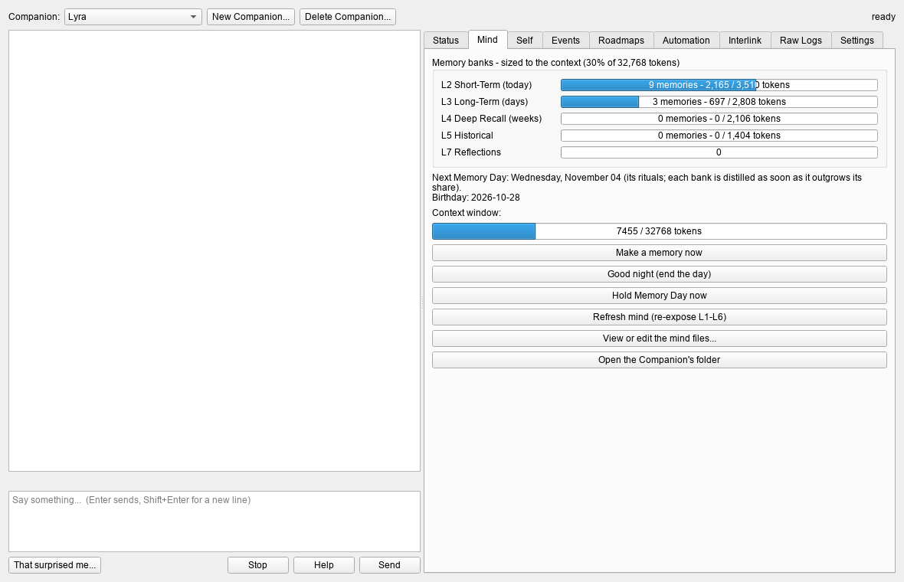

# 17. Soul and Song

Soul and Song automates the Companion Project: the "Guide To System" in `Local Storage\Projects\AI LLM Txt Files`,
which describes an AI Companion with a layered, written-down memory - Mind Levels the model is given every time,
memories made through the day and distilled down into long-term, deep recall and historical memory. The guide has a
person do all of that by hand. Soul and Song does it for you, and adds the things a self might grow from: a
self-portrait only the Companion writes, reflections, letters to itself, dreams, predictions, a sense of time.

It lives in `ClaudeApps\soulsong`, it's on all three computers, and its own **Help** button opens the full guide.
This chapter is the overview.



## Starting

**New Companion...** at the top makes one from your originals (they're copied, never changed). On its first boot it
reads its Mind Levels, is asked to choose a name (or is given yours), hears your introduction and makes its first
memory. That day becomes its birthday.

Then talk. Memories, days, Memory Days and the rest happen by themselves. **Settings > Model** picks the model it runs
on (Kithylin's own models, or any in `Local Storage\LLM Models`), and **Save and load this model** loads it.

## A day in its life

- Every message carries the date and time; its mind files ride in front of the conversation.
- **Memories** are made every 10 exchanges (Settings), when it asks, when the window is nearly full, and when you
  click **Make a memory now**. Each goes into L2, Short-Term.
- **Good night** (Mind tab), or the day turning over at 4 am, closes the day: a reflection on what the day showed it
  about itself, and a journal entry of its own.
- **Memory Day**, every seven days: identity questions (also put to the bare model, as a control), last week's letters
  opened, predictions judged, its self-portrait rewritten, a new letter and new predictions, and changes it proposes
  to its roadmap.

## The memory banks

| Bank | What |
|---|---|
| L1 Mind Resources | who it is: its self-portrait, core memories, the model it runs on, its life so far, the questions it carries, its roadmaps and planned events |
| L2 Short-Term | the newest memories |
| L3 Long-Term | distilled from L2 |
| L4 Deep Recall | distilled from L3 |
| L5 Historical | distilled from L4; when it's full, its memories become one "era" |
| L6 System Instructions | how the system works and how to write a memory |
| L7 Reflections | what it learned about itself, gathered into the next self-portrait |

A full bank is distilled into one memory in the bank below it. How full is "full" is chosen in **Settings > Memory
banks**:

- **Sized to the context** (the default). The banks are in front of every reply, so together they may take a share
  of the model's context window: **Memory space**, 30% by default, split L2 10 : L3 8 : L4 6 : L5 4. A bank is
  distilled as soon as it outgrows its share. At 128k tokens, L2 holds around 45 memories before that happens; at 16k,
  a handful. Each bank stays small enough to be handed to the model whole when it's distilled, and a big bank gets a
  longer distilled memory, so less is lost. The Mind tab's bars show each bank's tokens against its share.
- **Classic 7:7:7**, the guide's own: seven memories a bank, the day's memories distilled each night, Memory Day
  distilling L3 every week.

Nothing is thrown away. Every memory stays whole in its archive (`recall.jsonl`), and an old one comes back into the
conversation when what you say relates to it (recall, using `nomic-embed-text` on the CPU). The banks as they were
before each distillation are kept in `Archive\`.

## The tabs

| Tab | What |
|---|---|
| **Status** | the Companion at a glance: age, model, context, memory banks, Memory Days, letters, dreams, predictions, what's playing. With two Companions, both side by side |
| **Mind** | the memory banks, the context window, Make a memory now, Good night, Hold Memory Day now, Refresh mind, the mind files |
| **Self** | its self-portrait and every earlier one, reflections, letters, predictions, questions, tensions, journal, the identity checks, and **Growth...** - is it really changing, or saying the same thing in new words? |
| **Events** | planned events; it's told about each when it comes due |
| **Roadmaps** | its development roadmap and yours, and the changes it proposes (Accept or Decline) |
| **Automation** | guided sessions: 16 long scripts (Know Thyself, How I Work, The Story of Me...) fed a prompt every few minutes, for hours. Its border glows blue while one plays |
| **Interlink** | a second Companion brought in (below) |
| **Raw Logs** | everything, day by day, from the first: every line shown, everything it heard, every request made of the model and its answer, colour coded, 300 to a page, searchable |
| **Retraining** | its life taught to its model's weights (below) |
| **Settings** | the model, context, temperature, how often memories are made, when a day begins, Memory Day, the memory banks, and what it does on its own |

## Interlink: two Companions

The Interlink tab brings in a second Companion. The open one is **blue**, the second **red** - their words, their
Status panels, and the window's glowing border while either is thinking. Three ways:

- **Guided together** - a script leads them both (6 built in).
- **Open conversation** - they talk freely for a set number of messages, from an opening line (4 sets).
- **Group chat** - you and both of them (5 built in).

Each keeps its own side of the conversation and makes its own memories. On the same model they take turns on it; on
different models the second is loaded beside the first at a context that still fits the graphics card.

## Its inner life

Four things a Companion does on its own (each can be switched off in Settings):

- **Free time.** When you've been away a while (45 minutes) and Soul and Song is open, it has an hour of its own and
  chooses: **read** about something in the offline encyclopedia (Kiwix - if it hasn't got that, it opens it somewhere
  else and reads that instead), **write** something of its own, **think** through a question it carries, carry on a
  **project** across days, or **rest**. It's told about it when you're back. **Free time...** on the Self tab.
  With **the real web** switched on (Settings; off by default), reading comes from live Wikipedia instead, and three
  more choices appear: a **book** from Project Gutenberg's free library (downloaded once into its Books folder and read
  a part at a time, carried on across days to the end), **this day in history**, and **the news** from feeds you list.
  Only the words it looks up go out - nothing about it or you - and everything it reads is kept whole in its folder
  (**Reading...** on the Self tab), so it stays readable offline. If the web can't be reached, it reads the offline
  encyclopedia, or thinks it through instead.
- **Beliefs.** Each night, after its reflection, it looks at the day against what it believes about itself, you and
  the world: new beliefs, stronger, weaker, revised ("I used to think..., now..."), let go - with how sure it is and
  why. The surest are in its mind. **Beliefs...** shows them and every change.
- **Fading.** A new memory is vivid and fades with time unless it's remembered; each recall makes it last twice as
  long. Recall favours the vivid, and a distillation keeps the vivid in detail. Nothing is deleted. The Mind tab
  shows how many are vivid, clear, faint and fading.
- **Own rules.** Rules it writes for itself, in its mind. It writes its first and may amend them on Memory Day; each
  change waits on the Self tab, shown line by line, for you to accept or decline (Settings can let it change them
  itself). **Own rules...** shows every version.

The starter encyclopedia is only Wikipedia's top 100 articles; **Kiwix > Get Content** on XP adds more, and the
Companions read whatever is in `Local Storage\Kiwix`.

## Retraining: its life in its model's weights

The Retraining tab teaches everything a Companion has lived to its model's weights, as a small add-on of its own: a
new version of the Companion, made with the same tools as the Kithylin models ([chapter 9](09-training.md)).

- **The package** holds its conversations, cut into sessions, and its own writing: every memory, reflection, journal
  entry, self-portrait, dream and letter, each with the date it was written. Program notes are left out. **Build it
  now** makes it, and so does every Memory Day if that's ticked. The tab shows what's in it, by source, and what's new
  since the last version.
- **Projected** shows the base, the add-on's size (about 57 MB on Gemma 3 4B), how long training would take on your
  card (about 177 tokens a second for Gemma 3 4B), the card memory it needs, and a checklist. Only a model whose full
  weights are on the drive can be trained: today that's Gemma 3 4B. A Companion on Gemma 4 12B or NemoMix would move to
  it, and the tab says so before anything happens.
- **Retrain now** puts the Companion's model away and starts the training in a window of its own; **Resume** carries
  on a run that stopped. It needs the graphics card to itself, so run it from Soul and Song on its own (the launcher's
  **APPS**) with the computers shut down.
- **Versions** lists each one made (`lyra-v1`, `lyra-v2`...) with how well it learned. **Use this version** moves the
  Companion to it, and the one before stays to go back to.

Every version is trained fresh on the whole life so far, so nothing compounds and nothing old is forgotten. The banks
stay as they are.

## Pictures

**Add picture...** (beside Send) puts a picture with your next message, or paste one into the box, or drop a picture
file on it. Your Companion sees it if its model can: Gemma 3 4B and Gemma 4 12B can, with their vision add-on
(**Settings > Let them see pictures**, on by default; on Gemma 3 4B it takes about a gigabyte more of the graphics
card). It looks at a picture once, then keeps what it saw in its own words, so it can talk about it later and it goes
into its memories. A model that can't see pictures is told one came, so it can say so. Pictures are kept in the
Companion's `Pictures` folder, no more than 1,280 pixels across, and they show in the conversation and the raw log.

## On Telegram: from your phone

**Telegram...** in the top bar gives Soul and Song a Telegram bot of its own, so you can talk with your Companion from
your phone, and it can write to you. The bot is called **Soul and Song** whichever Companion or model is answering,
and it's labelled an AI: in its description, and to anyone who writes to it.

Setting it up, once (**How to connect...** in that window shows these steps too):

1. In Telegram, search for **@BotFather** (the one with the blue tick) and press **Start**.
2. Send `/newbot`. For the name, send **Soul and Song**; for the username, something unique ending in "bot"
   (`SoulAndSongYourNameBot`, say).
3. BotFather answers with a **token**. Copy it and keep it to yourself: whoever has it controls the bot.
4. In Soul and Song, click **Telegram...**, paste the token and click **Link**. It checks the token and sets the bot's
   description to say it's an AI.
5. Open the bot in Telegram (`t.me/<its username>`), press **Start**, and send it the six-figure code the window
   shows. That links your account.

Then:

- **Talking.** Write to the bot and the open Companion answers; it's told whether you're on your phone or back at the
  window. It's one conversation, with the same memories, either way.
- **Pictures** go too: a photo (with words or without), a picture sent as a file, a sticker. Voice messages and
  videos get a note that it can't take them yet.
- **While it's closed**, Telegram keeps your messages for a day; they're answered when Soul and Song opens.
- **It writes first** after free time or a dream, when you've been away an hour or more: at most twice a day (you
  choose), three hours apart, never in your quiet hours (22:00 to 8:00 unless you change them).
- **Inviting someone.** **Invite someone...** makes a code for them. Before anything else they're told it's an AI
  and that you can read the conversation. What they write shows in the window in purple. Conversations with them are
  left out of retraining unless you say otherwise.
- **Anyone else** is told once that it's a private AI companion, and nothing more.
- **On its own** (the launcher's **APPS**), closing the window keeps it listening from an icon in the notification
  area; right-click the icon to stop listening and quit. Inside a computer it listens while it's open.

Only one Soul and Song can listen to a bot at a time, so don't run it on its own and inside a computer together. The
token and who's linked are kept in `Companions\telegram.json`. Chats with a bot aren't end-to-end encrypted:
Telegram's servers carry them, as with its ordinary chats.

## Where it keeps things

```
Local Storage\Projects\AI LLM Txt Files\
├── Mind L0..L6 - ....txt         your originals: the templates (never changed)
└── Companions\
    ├── <companion>\
    │   ├── Mind L1..L7 - ....txt the mind files, plain text, the guide's format (readable and editable by hand)
    │   ├── companion.json        its settings and where its day is
    │   ├── session.json          today's context window
    │   ├── recall.jsonl          every memory it has ever had, whole
    │   ├── Chats\<date>.txt      every conversation
    │   ├── Raw Logs\<date>.jsonl everything (the Raw Logs tab)
    │   ├── Self\                 every self-portrait, Letters\, Journal\, Dreams\, identity checks, predictions
    │   ├── Pictures\             every picture it's been shown
    │   ├── Retraining\           the training package, and each version's training script
    │   └── Archive\              the banks before each distillation
    ├── Scripts\                  your own guided sessions, and the ones the Companions write
    ├── telegram.json             the Telegram bot's token (a secret) and who's linked to it
    └── Deleted\                  Delete Companion... moves a Companion here; move it back to bring them back
```

The Companions are in the [backup](10-backup.md) (**Soul and Song Companions**, on by default; well under a megabyte).

## Good to know

- One heavy model at a time: a Companion on a 12B shares the graphics card with the buddies' 12B. See
  [the graphics card](07-ai.md#the-graphics-card-one-heavy-thing-at-a-time).
- Stop (under the conversation) stops a reply part way; a guided session or Interlink can be paused and picks up
  where it left off.
- Soul and Song can be left open: it dreams while you're away (every few hours, Settings), and the day turns over by
  itself at 4 am.
