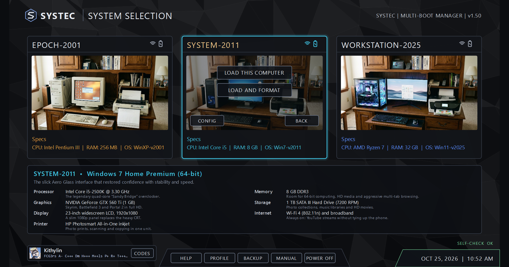

# The Claude Timeline Manual

Three computers from three moments in time - a Windows XP machine from October 2001, a Windows 7 machine from
October 2011 and a Windows 11 machine from October 2025 - sharing one archive, one cast of characters, one set of
games, and one version of you.

This manual is for the day you come back to it after a long break: how to start it, what everything is, where your
things are kept, how to keep them safe, and what to do when something breaks. It lives in the `Manual` folder at the
top of the Timeline as plain Markdown files, so it can be read with nothing running at all, in any text editor, or on
GitHub.

## Contents

1. [What's in the box](01-overview.md) - the three computers, the folder map, what's shared and what's each
   computer's own, where your things live
2. [Starting and stopping](02-starting.md) - Windows and Mac, the SYSTEC launcher, your profile and codes, the
   self-check, booting a computer, formatting one, shutting down
3. [The three computers](03-computers.md) - EPOCH-2001, SYSTEM-2011 and WORKSTATION-2025, their keys, and what
   each has that the others don't
4. [The residents and the community](04-residents.md) - who lives here, how they age across the eras, the
   messengers of each era, the Furry Web, how your codes change how they treat you
5. [The archive and Local Storage](05-archive.md) - the external drive, the viewers, ClaudeTV, the chat logs,
   Kiwix, your galleries
6. [Games](06-games.md) - every game, the emulators and their keys, the shared saves
7. [The language models](07-ai.md) - what runs the talking, which model does which job, the graphics card,
   ClaudeAI and the Copilot programs
8. [Kithylin AI](08-kithylin.md) - chatting with the model of you
9. [Training a new Kithylin](09-training.md) - from chat logs to a model: the pipeline, the three models so far,
   how long it takes, what to close first, and the lessons learned the hard way
10. [Backup and restore](10-backup.md) - what's backed up, where, automatic backups, restoring, and what isn't
    covered
11. [The self-check and troubleshooting](11-troubleshooting.md) - what the self-check looks for, and what to do
    when a computer won't boot, the drive vanishes, the models won't talk, or training stops
12. [On a Mac](12-mac.md) - what works on the MacBook, how it's wired, and what's different
13. [Under the hood](13-under-the-hood.md) - for whoever changes it next: how programs are registered, how shared
    programs talk to a computer, adding a game, the portable Python, the launcher .exe, git
14. [What's in Local Storage](14-local-storage.md) - the inventory of the drive: every folder with its file count,
    size and what kinds of files are in it. The project isn't meant to run without this

## The short version

- Plug the SSD into a **USB 3 port** (blue, or marked SS). Double-click **Claude Timeline.exe** (Windows) or
  **Claude Timeline.command** (Mac).
- Pick a computer and click **LOAD THIS COMPUTER**. Each boots like the real thing. **F11** for full screen.
- Shut the computer down from its own Start menu. The launcher comes back.
- **BACKUP** in the launcher saves your game progress, each computer's mail and memories, your profile and your
  Kithylin chats into one zip. Turn on the automatic backup once and forget about it.
- Never pull the drive while a computer is running or a model is training.
- The models and the media live in `Local Storage`, which isn't in git. The models of you live in
  `ClaudeApps\kithylinai\Models`. Both are irreplaceable; the cold backup on the 4 TB drive is what saves you.
